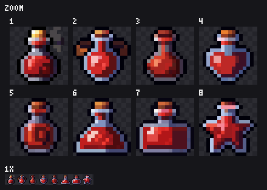

# Pixel Atlas

A Claude Code skill that adds references, palettes and quality benchmarks from the
[Pixel Art Atlas](https://huggingface.co/datasets/Angais/pixel-art-atlas-1.4m) to
[Codixel](https://github.com/mankidev/codixel).

Codixel makes better pixel art from a reference image than from imagination. When you
don't have one, Pixel Atlas finds similar sprites among 1.4 million 16x16 sprites so you
can pick a base, mines the colors those sprites use, and checks a finished sprite against
them.



## Install

Needs [Codixel](https://github.com/mankidev/codixel), Python 3 with numpy and Pillow, and Node.

```
git clone https://github.com/mankidev/codixel ~/.claude/skills/codixel
git clone https://github.com/WheresRace/pixel-atlas ~/.claude/skills/pixel-atlas
cd ~/.claude/skills/pixel-atlas
python -I scripts/atlas.py setup
```

`setup` downloads the 260 MB dataset ZIP from Hugging Face and extracts about 800 MB to
`~/.cache/pixel-atlas` (change it with `PIXEL_ATLAS_DIR`). Nothing from the dataset is
stored in this repository.

## Use

Ask Claude for it: "find me atlas references for an ice slime", "what colors do atlas
potions use", "benchmark my sprite against atlas slimes". Or run it yourself:

```
python -I scripts/atlas.py subjects slime                     # matching subject labels
python -I scripts/atlas.py search "red potion" --n 8 --out refs/potion
node scripts/sheet.js refs/potion --cols 4                     # numbered review sheet
python -I scripts/atlas.py palette "green slime" --k 8         # main colors, dark to light
python -I scripts/atlas.py bench my_slime.png --like slime     # stats vs the atlas
```

`bench` prints your sprite's colors, flat-color share, fill, lightness range, saturation
and outline darkness next to the atlas's 10th, 50th and 90th percentile for that subject:

```
my_slime.png vs 157 atlas sprites of 'green slime' (by caption words)
  stat           yours     p10  median     p90
  colors         7.000  11.000  17.000  25.000  <- low
  top_share      0.312   0.231   0.297   0.375
  fill           0.759   0.671   0.734   0.810
  value_range    0.498   0.565   0.694   0.796  <- low
  saturation     0.498   0.510   0.565   0.626  <- low
  dark_edge      1.000   0.961   1.000   1.000
```

See [SKILL.md](SKILL.md) for how Claude uses each part together with Codixel.

## About the data

Read the [dataset card](https://huggingface.co/datasets/Angais/pixel-art-atlas-1.4m) before you use the sprites.

- 1,409,404 sprites, all native 16x16 with transparent backgrounds, 6,194 subjects.
- Every sprite is **AI-generated** with Krea 2 Turbo and a pixel art LoRA, by Angais.
- Captions describe the prompt. Nobody has checked them against the images, so they are approximate.
- Angais releases the sprites, captions and collection under **CC0 1.0** to the extent Angais can
  waive rights. This does not cover third-party material, trademarks or Krea's models, and it does
  not override the Krea 2 Community License (including its commercial-use terms, §2.3) or Krea's
  Acceptable Use Policy. It is not an official Krea release.
- Everything is 16x16. For bigger sprites the atlas is a guide for silhouette, pose and palette,
  not a source of detail.

If you will ship atlas sprites in a commercial game, check the Krea terms yourself. Using the
atlas only for shape and color references is the safer path.

## License

The code in this repository is MIT (see [LICENSE](LICENSE)). It calls Codixel's `core/pixel.js`
(MIT, © mankidev) but does not include it. The dataset is not part of this repository and keeps
its own terms.
